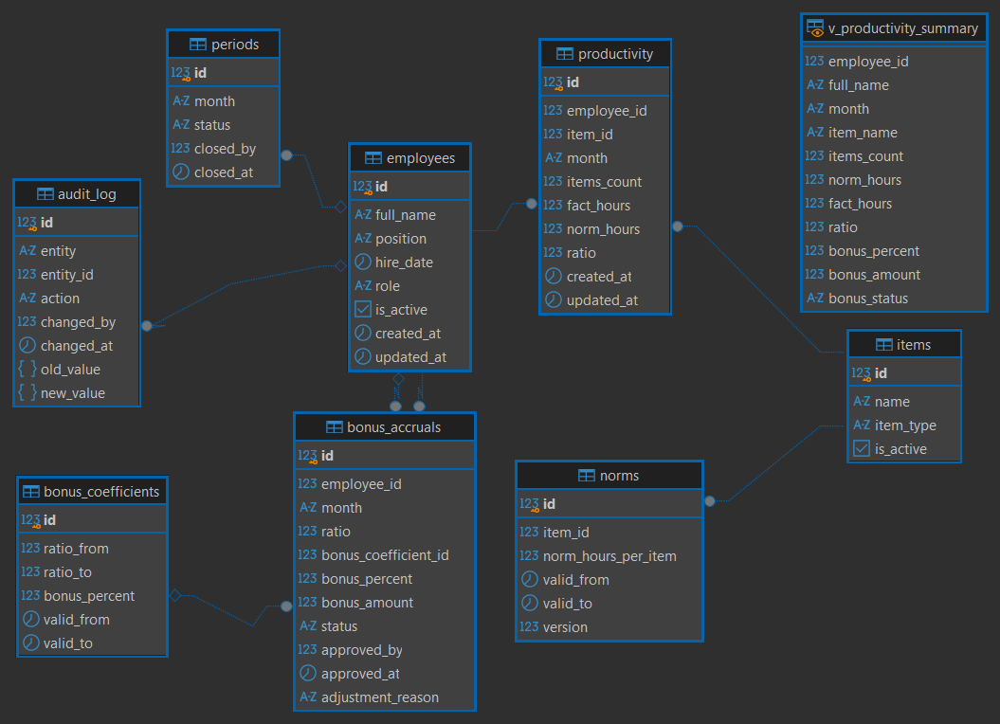

# Проект: База данных для учёта выработки и расчёта премий

Проект по проектированию реляционной базы данных для производственного участка. Включает учёт выработки сотрудников, расчёт премий и утверждение начислений.

## Цель проекта

Автоматизировать учёт выработки монтажников и расчёт премий, чтобы мастер и начальник участка могли объективно оценивать продуктивность сотрудников и распределять премии на основе данных, а не субъективных оценок.

## Структура репозитория

- `schema.sql` — DDL-скрипт для PostgreSQL: создание 8 таблиц, связей, индексов и view.
- `schema.dbml` — DBML-описание схемы для быстрой визуализации в dbdiagram.io.
- `ERD_sql.png` — ER-диаграмма из DBeaver (SQL-версия).
- `ERD_dbml.png` — ER-диаграмма из dbdiagram.io (DBML-версия).
- `features/features.md` — описание трёх фич (учёт выработки, расчёт премий, утверждение).
- `sql-analysis/queries.sql` — SQL-запросы для анализа данных (контроль выработки, сводная таблица, аудит).
- `diagrams/feature-1/feature-1-bpmn-accounting.png` — BPMN AS-IS/TO-BE для фичи 1 (учёт выработки).
- `diagrams/feature-2/feature-2-bpmn-calculation.png` — BPMN AS-IS/TO-BE для фичи 2 (расчёт премий).
- `diagrams/feature-3/feature-3-bpmn-approval.png` — BPMN AS-IS/TO-BE для фичи 3 (утверждение премий).
- `diagrams/sequence1.png` — Sequence-диаграмма (UML) для фичи 1.
- `diagrams/sequence1.puml` — исходный код Sequence-диаграммы для фичи 1.
- `diagrams/sequence2.png` — Sequence-диаграмма (UML) для фичи 2.
- `diagrams/sequence2.puml` — исходный код Sequence-диаграммы для фичи 2.
- `diagrams/c4-context.md` — C4 Context (Level 1): кто пользуется системой и с чем она связана.
- `diagrams/c4-container.md` — C4 Container (Level 2): из чего состоит система внутри.

## Архитектура (C4)

- [C4 Context (Level 1)](diagramsc4-context.md)
- [C4 Container (Level 2)](diagramsc4-container.md)

## Стек

- **PostgreSQL** — СУБД.
- **SQL (DDL, DML)** — создание структуры и работа с данными.
- **DBeaver** — инструмент для работы с базой (создание таблиц, выполнение скриптов, экспорт ERD).
- **DBML** — язык описания схемы для быстрой визуализации в dbdiagram.io.
- **PlantUML** — текстовое описание Sequence-диаграмм.

## Схема базы данных

### Основные таблицы

1. `employees` — сотрудники (ФИО, должность, роль).
2. `items` — изделия (наименование, тип).
3. `norms` — нормы времени на изделие (с версионностью).
4. `productivity` — выработка сотрудников по месяцам.
5. `bonus_coefficients` — справочник коэффициентов премии.
6. `bonus_accruals` — начисления премий.
7. `periods` — расчётные периоды (открыт/закрыт).
8. `audit_log` — журнал аудита изменений.

### Представление

- `v_productivity_summary` — сводная выгрузка: сотрудник, изделие, норма, факт, соотношение, премия.

## Sequence-диаграммы (UML)

Основные сценарии для каждой фичи:

- [Sequence для фичи 1 (учёт выработки)](diagrams/feature-1/sequence1.png)
- [Sequence для фичи 2 (расчёт премий)](diagrams/feature-2/sequence2.png)

## SQL-анализ данных

Примеры запросов — в файле [`sql-analysis/queries.sql`](sql-analysis/queries.sql).

1. Ежедневный контроль выработки: агрегация по сотруднику и месяцу, выявление отставаний.
2. Сводная таблица для мастера: JOIN `employees + productivity + items + norms` с расчётом `ratio`.
3. Выгрузка для отчёта: SQL-view `v_productivity_summary`, используется для экспорта и показа сотрудникам.
4. Сотрудники с отставанием (ratio < 1) за месяц.
5. История изменений по сотруднику (для аудита).

## SQL и DBML: зачем оба

В проекте есть два описания схемы — это не дублирование, а два разных инструмента для разных задач:

- **SQL (`schema.sql`)** — реальный код, который создаёт базу в PostgreSQL. Показывает навык работы с СУБД: DDL, связи, индексы, view.
- **DBML (`schema.dbml`)** — декларативное описание схемы для быстрой визуализации и обсуждения. Показывает навык проектирования и работы с инструментами визуализации.

SQL — для работы, DBML — для проектирования и коммуникации.

## Как запустить

1. Установить PostgreSQL и DBeaver.
2. Создать базу данных.
3. Выполнить `schema.sql` в SQL-редакторе DBeaver (Alt+X для всего скрипта).
4. Обновить соединение (F5) — таблицы появятся в схеме `public`.

## Что демонстрирует проект

- Проектирование реляционной модели (8 таблиц, связи 1:N, N:1).
- Работа с версионностью справочников (нормы, коэффициенты).
- Ролевая модель и разграничение доступа.
- Журнал аудита и блокировка периодов.
- Написание DDL-скриптов и работа в DBeaver.
- Визуализация схемы через DBML и ER-диаграмму.
- Построение BPMN AS-IS/TO-BE и Sequence-диаграмм (UML).
- Работа с C4-моделью (Context и Container).
- Написание SQL-запросов для анализа данных.

## Блок 1: «Регистрация и классификация дефектов»

**Цель:** Автоматизировать сбор и классификацию данных о дефектах, чтобы выявлять этапы производства с наибольшим числом ошибок и принимать решения на основе данных, а не субъективных наблюдений.

**Основные функции:**
1. Хранение информации о дефектах: изделие, этап производства, тип дефекта, сотрудник, дата.
2. Классификация дефектов по типам (технологический, человеческий фактор, дефект материала).
3. Привязка дефекта к этапу производственного процесса (по BPMN-модели).
4. Формирование сводной таблицы дефектов по этапам и типам за период.

**Ценность для бизнеса:**
1. Мастер и начальник участка видят, на каких этапах больше всего ошибок, а не догадываются об этом.
2. Появляется объективная база для принятия решений: где обучать, где менять процесс.
3. Снижение количества дефектов за счёт точечного вмешательства в проблемные этапы.

**Ценность для пользователя (мастера):**
1. Быстрый доступ к данным о дефектах по своему участку.
2. Возможность показать сотруднику, на каком этапе он чаще ошибается.
3. Основа для рекомендаций по обучению без ручного анализа.

---

## Блок 2: «Анализ зон риска и рекомендации по обучению»

**Цель:** На основе данных о дефектах выявить зоны риска (этапы с наибольшим числом ошибок) и сформировать рекомендации по точечному обучению сотрудников и стажёров.

**Основные функции:**
1. Анализ дефектов по этапам производства (на основе BPMN-модели AS-IS).
2. Выявление этапов с наибольшим числом ошибок (зоны риска).
3. Формирование рекомендаций по обучению: какие этапы требуют дополнительного внимания.
4. Разработка сценария обучения стажёров на основе выявленных зон риска.

**Ценность для бизнеса:**
1. Обучение становится точечным, а не «для всех и обо всём» — экономия времени и ресурсов.
2. Снижение количества ошибок у новых сотрудников за счёт сценария обучения, основанного на реальных данных.
3. Снижение количества ошибок по всему участку за счёт устранения системных проблем на проблемных этапах.

**Ценность для пользователя (начальника участка):**
1. Понятная картина: где ошибаются чаще, кого и чему учить.
2. Возможность обосновать обучение данными, а не «мне кажется».
3. Снижение текучести кадров за счёт более быстрой адаптации стажёров.

---

## Блок 3: «Интеграция и передача данных о дефектах»

**Цель:** Описать требования к интеграции данных о дефектах с системой завода через REST API и структуру данных в JSON, чтобы данные передавались без дублирования и потерь.

**Основные функции:**
1. Описание структуры данных дефекта в формате JSON (изделие, этап, тип дефекта, сотрудник, дата).
2. Описание требований к REST API для передачи данных о дефектах.
3. Валидация решения на уровне пилотного участка (на базе Excel-таблицы).
4. Передача наработок IT-отделу для масштабирования.

**Ценность для бизнеса:**
1. Данные о дефектах передаются без дублирования и потерь.
2. Пилот на Excel-таблице показал эффективность до внедрения полноценной системы.
3. Решение готово к масштабированию на другие участки.

**Ценность для пользователя (IT-отдела):**
1. Понятная структура данных и требования к API — можно сразу разрабатывать.
2. Пилот подтвердил логику, снижен риск ошибок при разработке.
3. Передача наработок без потери контекста.
