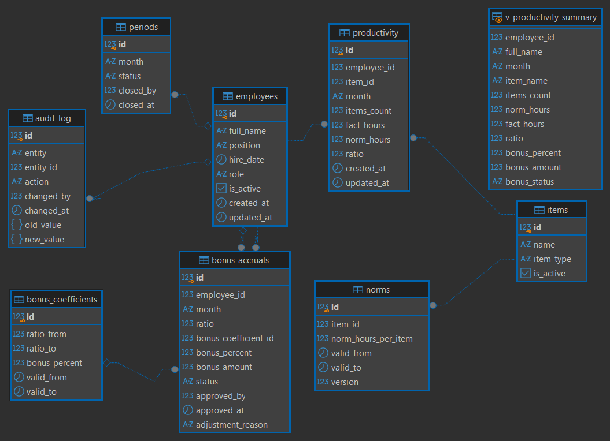

# Проект: База данных для учёта выработки и расчёта премий

Проект по проектированию реляционной базы данных для производственного участка. Включает учёт выработки сотрудников, расчёт премий и утверждение начислений.

## Цель проекта

Автоматизировать учёт выработки монтажников и расчёт премий, чтобы мастер и начальник участка могли объективно оценивать продуктивность сотрудников и распределять премии на основе данных, а не субъективных оценок.

## Структура репозитория

- `schema.sql` — DDL-скрипт для PostgreSQL: создание 8 таблиц, связей, индексов и view.
- `schema.dbml` — DBML-описание схемы для быстрой визуализации в dbdiagram.io.
- `ERD_sql.png` — ER-диаграмма из DBeaver (SQL-версия).
- `ERD_dbml.png` — ER-диаграмма из dbdiagram.io (DBML-версия).
- `features/features.md` — описание трёх фич (учёт выработки, расчёт премий, утверждение).
- `sql-analysis/queries.sql` — SQL-запросы для анализа данных (контроль выработки, сводная таблица, аудит).
- `diagrams/feature-1/feature-1-bpmn-accounting.png` — BPMN AS-IS/TO-BE для фичи 1 (учёт выработки).
- `diagrams/feature-2/feature-2-bpmn-calculation.png` — BPMN AS-IS/TO-BE для фичи 2 (расчёт премий).
- `diagrams/feature-3/feature-3-bpmn-approval.png` — BPMN AS-IS/TO-BE для фичи 3 (утверждение премий).
- `diagrams/c4-context.md` — C4 Context (Level 1): кто пользуется системой и с чем она связана.
- `diagrams/c4-container.md` — C4 Container (Level 2): из чего состоит система внутри.

## Архитектура (C4)

- [C4 Context (Level 1)](diagrams/c4-context.md)
- [C4 Container (Level 2)](diagrams/c4-container.md)

## Стек

- **PostgreSQL** — СУБД.
- **SQL (DDL, DML)** — создание структуры и работа с данными.
- **DBeaver** — инструмент для работы с базой (создание таблиц, выполнение скриптов, экспорт ERD).
- **DBML** — язык описания схемы для быстрой визуализации в dbdiagram.io.

## Схема базы данных

### Основные таблицы

1. `employees` — сотрудники (ФИО, должность, роль).
2. `items` — изделия (наименование, тип).
3. `norms` — нормы времени на изделие (с версионностью).
4. `productivity` — выработка сотрудников по месяцам.
5. `bonus_coefficients` — справочник коэффициентов премии.
6. `bonus_accruals` — начисления премий.
7. `periods` — расчётные периоды (открыт/закрыт).
8. `audit_log` — журнал аудита изменений.

### Представление

- `v_productivity_summary` — сводная выгрузка: сотрудник, изделие, норма, факт, соотношение, премия.

## SQL и DBML: зачем оба

В проекте есть два описания схемы — это не дублирование, а два разных инструмента для разных задач:

- **SQL (`schema.sql`)** — реальный код, который создаёт базу в PostgreSQL. Показывает навык работы с СУБД: DDL, связи, индексы, view.
- **DBML (`schema.dbml`)** — декларативное описание схемы для быстрой визуализации и обсуждения. Показывает навык проектирования и работы с инструментами визуализации.

SQL — для работы, DBML — для проектирования и коммуникации.

## Как запустить

1. Установить PostgreSQL и DBeaver.
2. Создать базу данных.
3. Выполнить `schema.sql` в SQL-редакторе DBeaver (Alt+X для всего скрипта).
4. Обновить соединение (F5) — таблицы появятся в схеме `public`.

## Что демонстрирует проект

- Проектирование реляционной модели (8 таблиц, связи 1:N, N:1).
- Работа с версионностью справочников (нормы, коэффициенты).
- Ролевая модель и разграничение доступа.
- Журнал аудита и блокировка периодов.
- Написание DDL-скриптов и работа в DBeaver.
- Визуализация схемы через DBML и ER-диаграмму.
